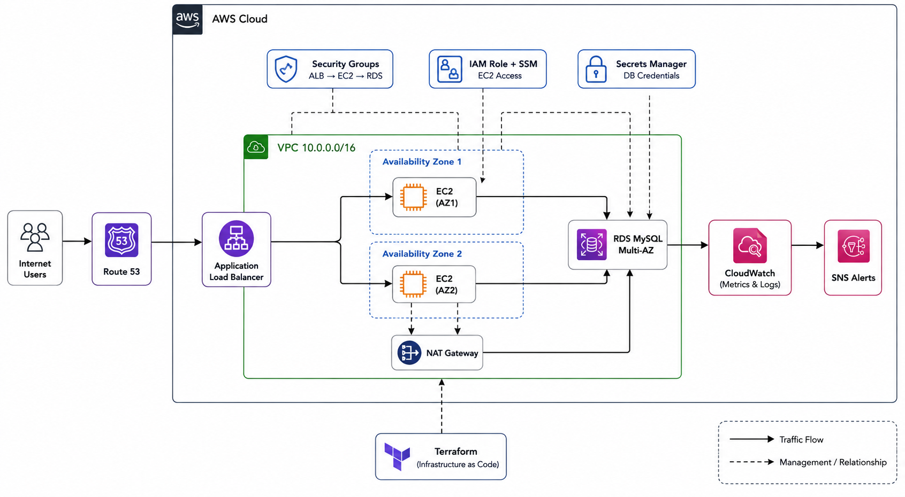

# AWS INFRASTRUCTURE WITH AI-POWERED INCIDENT INVESTIGATION AGENT

**Portfolio project:** Terraform-managed three-tier AWS infrastructure with an event-driven AI incident investigation agent.

## Overview

This repository combines a three-tier, highly available AWS application architecture with a separately managed AI incident triage system.

The infrastructure layer contains a VPC, public and private subnets across two Availability Zones, an Application Load Balancer, an EC2 Auto Scaling Group, RDS Multi-AZ, Secrets Manager, IAM roles and CloudWatch alarms.

The AI incident agent receives CloudWatch alarm state changes through EventBridge, gathers read-only metrics, application logs and ALB target health, and uses Amazon Bedrock Converse inference to produce an evidence-based incident report. SNS distributes reports, while API Gateway JWT authorization and DynamoDB support human approval records.

## Architecture

The incident agent design and workflow are documented in [ai-incident-agent/docs/architecture.md](ai-incident-agent/docs/architecture.md).

## Project status

The repository contains Terraform source, application code, automated tests and deployment instructions. The AI incident agent is designed for deployment into the existing VPC using a separate Terraform state. The presence of source code or screenshots is not proof that the complete AI agent is deployed or validated in a live AWS account.

The existing three-tier resources were previously used for hands-on learning and cost-conscious experimentation. Review the AWS account before deployment; resources may need to be recreated.

## Repository structure

\`\`\`text
Three-Tier-Secure-HA-AWS/
├── architecture/          design specification and diagrams
├── docs/                  infrastructure decisions, security and cost notes
├── kubernetes/            Kubernetes learning exercises
├── screenshots/           hands-on AWS console evidence
├── terraform/             three-tier application infrastructure
└── ai-incident-agent/     Bedrock-powered incident triage application
    ├── app/               diagnostics, security, analysis and workflow
    ├── handlers/          Lambda entry points
    ├── terraform/         separate AI agent infrastructure state
    ├── tests/             automated test suite
    └── docs/              architecture, security and deployment
\`\`\`

## Existing three-tier infrastructure

| Service | Purpose |
|---|---|
| VPC and subnets | Network separation across web, application and database tiers |
| Internet Gateway and NAT Gateway | Public ingress and controlled private egress |
| Application Load Balancer | Layer 7 routing and health checks |
| Auto Scaling Group | Elasticity and self-healing application instances |
| RDS MySQL Multi-AZ | Managed relational database and failover |
| Secrets Manager | Database credential storage |
| IAM roles and SSM | Temporary role credentials and managed instance access |
| CloudWatch and SNS | Monitoring and alarm notifications |

## AI incident triage agent

| Component | Responsibility |
|---|---|
| EventBridge | Routes CloudWatch alarm state changes |
| Lambda | Coordinates incident investigations |
| CloudWatch | Collects metrics and application logs |
| Elastic Load Balancing v2 | Reports target health |
| Amazon Bedrock | Produces evidence-based root-cause analysis |
| Bedrock Guardrails | Filters prompt attacks and sensitive information |
| SNS | Distributes incident and approval notifications |
| API Gateway JWT authorizer | Authenticates approval requests |
| DynamoDB | Stores approval state and expiry |
| CloudTrail | Records multi-region management events |
| Terraform | Provisions the AI agent infrastructure separately |

The agent does not autonomously modify EC2, Auto Scaling, RDS or load-balancer resources. Approval decisions are recorded, but a separate remediation executor is not included.

## Getting started

Start with the original infrastructure in [terraform/](terraform/). The AI incident agent has its own setup instructions in [ai-incident-agent/README.md](ai-incident-agent/README.md).

Before deploying the AI agent, publish the required root Terraform outputs, build the Lambda ZIP, configure the Bedrock inference profile and supply a real JWT issuer and audience. Follow [ai-incident-agent/docs/deployment.md](ai-incident-agent/docs/deployment.md).

## Security and cost

See [docs/security.md](docs/security.md) for the application controls and [ai-incident-agent/docs/security.md](ai-incident-agent/docs/security.md) for AI evidence handling, least privilege, network isolation and approval authorization.

Interface VPC endpoints, NAT Gateway usage, CloudTrail storage, Lambda, DynamoDB, SNS and Bedrock inference can incur charges. Review Terraform plans and [ai-incident-agent/docs/cleanup.md](ai-incident-agent/docs/cleanup.md) before deployment.

## Author

**V. Srinivasan** — Cloud Engineering · AWS · Terraform · Python
